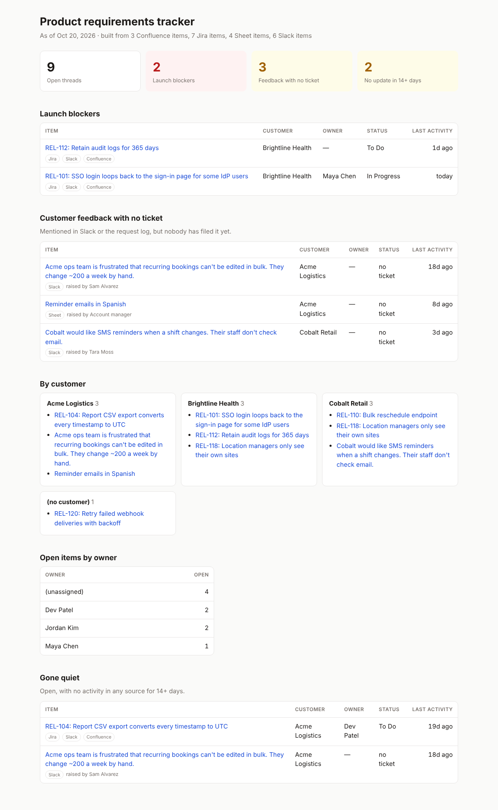

# requirements-tracker

One view of product requirements, pulled from the places they actually live: Slack, Jira, Confluence, and a Google Sheet request log.

During a customer launch, the information a product team needs is scattered. A blocker is raised in a Slack channel, the fix is a Jira ticket, the requirement is in a Confluence spec, and the customer's original ask is a row in someone's spreadsheet. Nobody has the whole picture, and feedback that never became a ticket quietly disappears.

This tool reads all four sources, links items that refer to the same Jira issue, and builds a single dashboard that answers:

- **What's blocking a launch right now?**
- **What have customers asked for that nobody has filed yet?**
- **What's open for each customer, and who owns it?**
- **What has gone quiet?**

It's a view, not a system of record: it only reads, never writes back, and is meant to be rebuilt on a schedule.



## How it works

1. **Pull.** Each source has a small connector:
   - Slack: `conversations.history` for the configured channels.
   - Jira: `/rest/api/3/search/jql`, with token paging.
   - Confluence: CQL content search with page bodies.
   - Sheets: the v4 values API.
2. **Normalize.** Every message, ticket, page, and row becomes the same `Item`. Each item gets a kind (blocker, feedback, work, spec), a customer, an owner or reporter, a status, and any Jira keys it mentions.
3. **Filter noise.** A Slack message is kept only if it reads as a blocker or as customer feedback (configurable keyword lists, or a 🚨 reaction), or if it references a ticket. Lunch plans don't make the dashboard.
4. **Link.** Items that mention the same Jira key are grouped into one thread anchored on the ticket. A spec mentioning two tickets appears under both. A ticket with no customer label inherits the customer from the conversation about it.
5. **Render.** The output is a self-contained `index.html` (works offline, light and dark mode) plus `items.csv` for anyone who wants to slice the data.

## Quick start

```bash
pip install -e ".[dev]"

# Build from the bundled sample data (a fictional SaaS company with three customers)
req-tracker build --config examples/tracker.toml \
  --sample examples/sample_data --as-of 2026-10-20 --out dist
open dist/index.html
```

```
slack          6 items
jira           7 items
confluence     3 items
sheets         4 items

9 open threads, 2 blockers, 3 untriaged, 2 stale
```

## Using it with real data

Copy `examples/tracker.toml` and fill in your channels, JQL, CQL, spreadsheet ID, and customers. Tokens come from environment variables, never the config file:

| Source | Needs |
| --- | --- |
| Slack | Bot token with `channels:history` (and `groups:history` for private channels) in `SLACK_TOKEN` |
| Jira / Confluence | Atlassian account email in `JIRA_EMAIL` and an API token in `JIRA_TOKEN` |
| Google Sheets | OAuth access token with spreadsheets read scope in `GOOGLE_ACCESS_TOKEN` |

```bash
req-tracker build --config tracker.toml --out dist
```

Leave a section out of the config to skip that source. Run it from cron or a scheduled CI job to keep the dashboard fresh.

## Project layout

```
src/req_tracker/
  sources/        one connector per system: fetch() calls the API, parse() normalizes
  models.py       the shared Item type and Jira key extraction
  tracker.py      linking items into threads; blockers, untriaged, stale, by customer/owner
  report.py       HTML dashboard and CSV export
  config.py       TOML config
examples/         sample config and saved API responses
tests/            23 tests
```

## Tests

```bash
pytest
```

The `parse()` side of every connector is tested against saved responses in each API's documented shape. The `fetch()` side (paging, auth, error handling) is tested with the HTTP layer mocked.

## Limitations

- Connectors haven't been run against a live workspace yet, only against documented response shapes and mocked HTTP.
- Classification is keyword-based. It's predictable and easy to tune, but it will miss feedback phrased in unexpected ways. An LLM classifier is the obvious next step.
- Slack threads (replies) aren't read yet, only top-level channel messages.
- Linking relies on Jira keys being mentioned. Feedback about the same thing in different words won't be grouped.

## License

MIT
